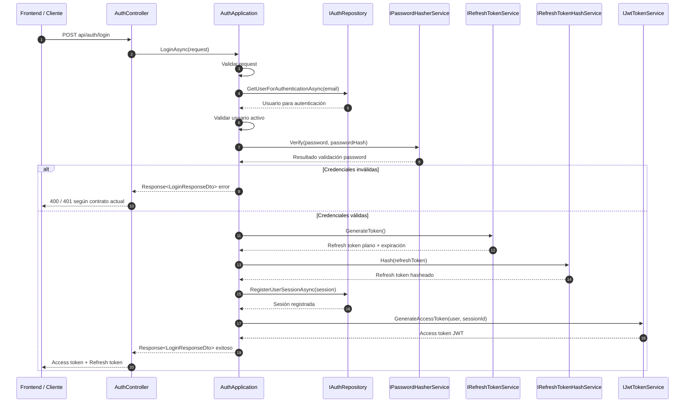
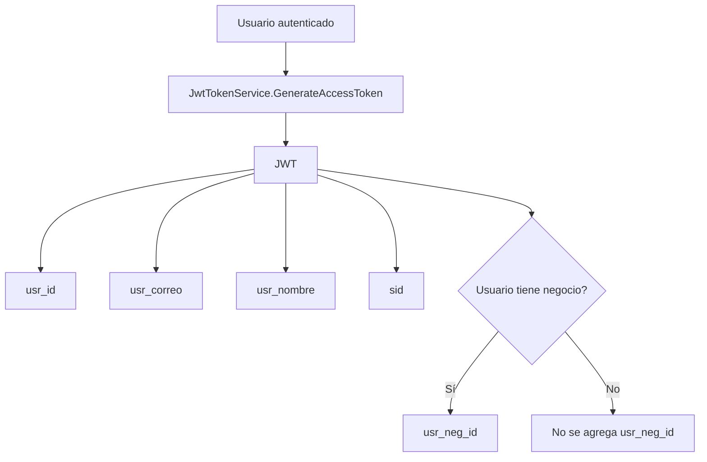
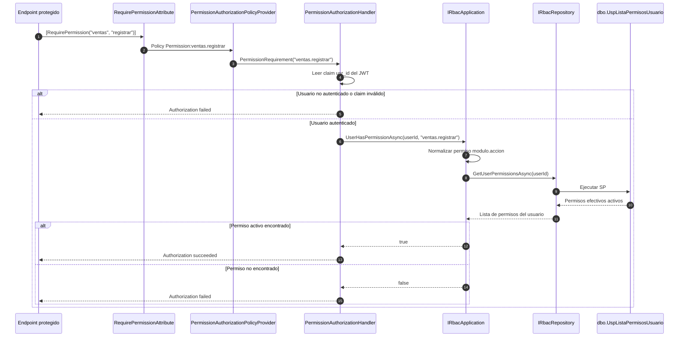
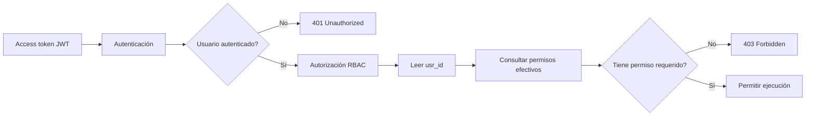

# Núcleo de gestión RBAC: roles y asignaciones

## 1. Objetivo

Esta fase completa las capas permanentes de Application y Repository necesarias para administrar:

- roles globales y roles asociados a negocio;
- permisos asignados a roles;
- roles asignados a usuarios;
- permisos efectivos de un usuario.

No se agregan controladores, menús de consola, SQL en línea, cambios de tablas ni cambios de stored procedures.

## 2. Arquitectura

El flujo implementado es:

```text
Consumidor futuro (WebAPI o Console.Tools)
    -> IRbacApplication / RbacApplication
        -> IRbacRepository / RbacRepository
            -> Dapper
                -> Stored Procedure
                    -> SQL Server
```

Application valida y normaliza contratos, coordina operaciones, usa AutoMapper y retorna `Response<T>`. Repository traduce los parámetros y columnas SQL, ejecuta únicamente stored procedures y convierte los resultados en entidades de dominio.

La interfaz de Repository usa entidades y parámetros simples. No depende de los DTOs de Application, con lo cual se conserva la dirección de dependencias entre proyectos.

## 3. Gestión de roles

Las operaciones disponibles permiten:

- listar roles con filtros por negocio, nombre, estado y alcance global;
- consultar un rol por identificador;
- crear un rol;
- actualizar un rol;
- inactivar lógicamente un rol.

Un `BusinessId` nulo representa un rol global. Un rol asociado a un negocio solo puede usarse dentro de las reglas de negocio validadas por los SP.

Los indicadores admitidos son:

```text
IsSystem: S/N
FullAccess: S/N
Status: A/I
```

`IsSystem` identifica roles protegidos por el sistema. `FullAccess` concede todos los permisos activos mediante la resolución del SP; son conceptos independientes.

## 4. Permisos asignados a roles

El núcleo permite listar asignaciones, asignar un permiso y revocarlo. La revocación es lógica: la relación pasa a estado `I`.

Si una asignación inactiva vuelve a asignarse, `UspAsignaPermisoRol` la reactiva. Application no replica esa regla ni intenta insertar directamente.

## 5. Roles asignados a usuarios

El núcleo permite listar asignaciones usuario-rol, asignar un rol y revocarlo. Los filtros disponibles incluyen usuario, rol, correo, nombre de rol y estado.

`UspAsignaRolUsuario` mantiene las reglas de existencia, estado y compatibilidad entre el negocio del usuario y el alcance del rol. Una relación inactiva se reactiva en lugar de duplicarse.

## 6. Permisos efectivos

`GetUserPermissionsAsync` conserva la integración existente con `UspListaPermisosUsuario`. El SP resuelve los roles activos y sus permisos activos. Cuando alguno de los roles tiene acceso total, retorna todos los permisos activos del sistema.

`UserHasPermissionAsync` normaliza el nombre `modulo.accion` y exige que el permiso solicitado exista como permiso activo dentro del resultado del SP. No existe bypass en C# para `FullAccess`.

## 7. Stored procedures consumidos

### Roles

```text
dbo.UspListaRoles
dbo.UspConsultaRol
dbo.UspCreaRol
dbo.UspActualizaRol
dbo.UspEliminaRol
```

### Rol-permisos

```text
dbo.UspListaRolPermisos
dbo.UspAsignaPermisoRol
dbo.UspRevocaPermisoRol
```

### Usuario-roles

```text
dbo.UspListaUsuarioRoles
dbo.UspAsignaRolUsuario
dbo.UspRevocaRolUsuario
```

### Permisos efectivos

```text
dbo.UspListaPermisosUsuario
```

Los métodos existentes para módulos, acciones y permisos técnicos permanecen disponibles y sin cambios de comportamiento.

## 8. Relación con `RequirePermission`

La autorización dinámica sigue este flujo:

```text
[RequirePermission("ventas", "registrar")]
    -> PermissionAuthorizationHandler
        -> IRbacApplication.UserHasPermissionAsync
            -> IRbacRepository.GetUserPermissionsAsync
                -> dbo.UspListaPermisosUsuario
```

Una asignación o revocación se refleja en la siguiente consulta de autorización sin emitir un JWT nuevo.

## 9. Permisos y roles no hardcodeados

El catálogo permanece en SQL Server. El nombre del permiso se deriva de `MOD_CODIGO + '.' + ACC_CODIGO`, y los roles son registros administrables. No existen enums ni listas centrales en C# para permisos o roles.

Esto evita que el código y la base de datos mantengan fuentes de verdad diferentes.

## 10. JWT mínimo

El JWT continúa almacenando identidad y sesión, no permisos ni roles. La autorización consulta el estado actual de RBAC, por lo que una revocación no depende de la expiración del access token.

Esta fase no modifica autenticación, generación de tokens, refresh tokens ni sesiones.

## 11. Flujo de autenticación

El flujo de autenticación se mantiene separado del flujo de autorización RBAC.

La autenticación valida identidad, credenciales y sesión.
La autorización RBAC valida permisos efectivos en tiempo de ejecución.

### 11.1. Login

El login inicia desde el endpoint `POST api/auth/login`.



### 11.2. Claims incluidos en el JWT

El access token contiene identidad y sesión.
No contiene permisos ni roles.



Claims actuales:

```text
usr_id
usr_correo
usr_nombre
sid
usr_neg_id opcional
```

El claim `usr_neg_id` solo se agrega cuando el usuario autenticado está asociado a un negocio.

---

## 12. Flujo de autorización RBAC

La autorización RBAC no depende de permisos embebidos en el JWT.

El JWT identifica al usuario y la sesión.
Los permisos efectivos se consultan contra el núcleo RBAC en cada validación de autorización.

### 12.1. Autorización dinámica con `RequirePermission`



### 12.2. Diferencia entre autenticación y autorización



La diferencia principal es:

```text
401 Unauthorized:
El usuario no está autenticado o el token no es válido.

403 Forbidden:
El usuario está autenticado, pero no tiene el permiso requerido.
```

---

## 13. Pruebas unitarias Auth/RBAC

Se agregó el proyecto de pruebas unitarias backend:

```text
UtpPos.Basico.WebAPI/UtpPos.Backend.Tests
```

El primer bloque de pruebas cubre el núcleo de autenticación y autorización sin tocar base de datos real.

### 13.1. Alcance cubierto

```text
AuthApplication
RbacApplication.UserHasPermissionAsync
PermissionAuthorizationHandler
PermissionAuthorizationPolicyProvider
```

### 13.2. Casos principales cubiertos

```text
Login exitoso.
Login con request inválido.
Login con usuario inexistente.
Login con usuario inactivo.
Login con contraseña incorrecta.
Refresh token válido e inválido.
Logout.
Logout all.
Consulta de usuario actual.
Validación de permiso activo.
Validación de permiso inexistente.
Validación de permiso inactivo.
Permisos case-insensitive.
Permisos con guion, por ejemplo terceros-global.listar.
Usuario no autenticado en handler de autorización.
Usuario autenticado sin claim usr_id.
Usuario con permiso.
Usuario sin permiso.
Policy dinámica Permission:modulo.accion.
```

### 13.3. Comando de ejecución

Desde la carpeta del proyecto de pruebas:

```bash
dotnet test
```

O desde la raíz del repositorio:

```bash
dotnet test "UtpPos.Basico.WebAPI/UtpPos.Backend.Tests/UtpPos.Backend.Tests.csproj"
```

Resultado esperado actual:

```text
Total: 48
Passed: 48
Failed: 0
Skipped: 0
```

### 13.4. Qué no cubre este bloque

Este bloque no cubre:

```text
AuthRepository
RbacRepository
Stored procedures
SQL Server real
Pipeline HTTP real
Respuestas reales 401 / 403 / 200
```

Esos escenarios pertenecen a pruebas de integración posteriores.

---

## 14. Consumo futuro

`UtpPos.Console.Tools` consume `IRbacApplication` para crear y administrar roles y asignaciones sin usar Dapper directamente. Su uso se documenta en `Docs/console-tools/README_RBAC_ROLE_MANAGEMENT.md`.

WebAPI podrá exponer controladores administrativos sobre el mismo contrato Application. Esos endpoints deberán protegerse con `[Authorize]` y los permisos RBAC correspondientes.

---

## 15. Pendientes

* implementar controladores administrativos RBAC en WebAPI cuando sean requeridos;
* agregar pruebas automatizadas de integración contra una base SQL Server controlada;
* agregar pruebas de integración para validar respuestas reales `401`, `403` y `200`;
* evaluar una caché de permisos y su estrategia de invalidación;
* evaluar Redis únicamente cuando el volumen de consultas lo justifique.

Redis no forma parte de esta implementación.

